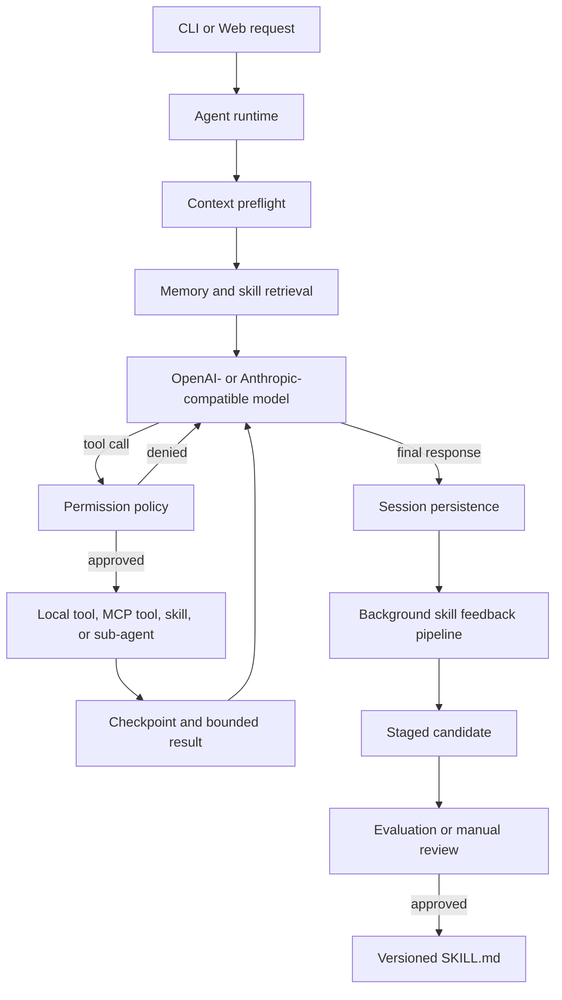

# GrowAgent

**A local, extensible agent runtime with permission-aware tools, structured context folding, MCP integration, sub-agents, and an evidence-gated skill evolution loop.**

GrowAgent is a Python runtime for building and studying tool-using AI agents. It provides one orchestration layer for model calls, tool execution, authorization, session recovery, long-term memory, context management, and reusable skills. The same runtime powers an interactive CLI and a local Web workspace.

The project supports both OpenAI-compatible and Anthropic-compatible APIs. It is designed to keep model providers replaceable while making operational behavior—permissions, state transitions, persistence, and failure recovery—explicit and testable.

## Highlights

- **Protocol-neutral agent loop** — normalizes OpenAI and Anthropic message formats, tool calls, streaming responses, usage accounting, and retry behavior.
- **Five permission modes** — `default`, `acceptEdits`, `dontAsk`, `bypassPermissions`, and read-only `plan` mode.
- **Read-before-write enforcement** — file edits require a prior read, and tool permissions are checked again immediately before execution.
- **Layered context management** — performs lightweight cleanup before requests, externalizes tool results larger than 30 KiB, and folds long sessions into structured episode, working, and tool memory.
- **MCP support without an SDK dependency** — discovers and invokes stdio MCP servers through newline-delimited JSON-RPC.
- **Sub-agent isolation** — includes read-only exploration and planning profiles, a general profile, and user-defined profiles with bounded tool access.
- **On-demand memory and skill retrieval** — keeps manifests in the system prompt and loads full content only when it is relevant.
- **Skill evolution with review gates** — extracts durable feedback, stages add/merge proposals, evaluates candidates against replay tasks, and supports approval, rollback, and stale-skill archival.
- **Recoverable execution** — persists sessions, checkpoints tool execution, isolates streaming retries, and resumes interrupted background skill work.
- **Offline regression suite** — exercises permission boundaries, session recovery, MCP routing, context folding, skill publication, Web APIs, and failure handling without paid model calls.

## Architecture



The runtime deliberately separates model reasoning from side effects. Models propose tool calls; GrowAgent validates schemas, applies the active permission policy, executes approved operations, persists results, and returns bounded tool output to the next model turn.

## Repository layout

```text
GrowAgent/
├── agents/
│   ├── agent.py                   # Agent loop and provider adapters
│   ├── context_runtime.py         # Context preflight and bounded recall
│   ├── tools.py                   # Built-in tools and permission policy
│   ├── mcp_client.py              # stdio JSON-RPC MCP client
│   ├── subagent.py                # Built-in and custom sub-agent profiles
│   ├── memory.py                  # Project-scoped long-term memory
│   ├── session_memory.py          # Structured context folding
│   ├── skills.py                  # Skill discovery, retrieval, and execution
│   ├── online_skill_evolution.py  # Feedback extraction and add/merge decisions
│   ├── online_skill_eval.py       # Replay-based candidate evaluation
│   ├── eval_folding.py            # Paired context-folding evaluation runner
│   ├── skill_evolution.py         # Versioning, provenance, and archival
│   ├── checkpoints.py             # Tool execution checkpoints
│   ├── result_storage.py          # External storage for large tool results
│   ├── main.py                    # CLI and interactive REPL
│   └── web.py                     # Local HTTP API and SSE event stream
├── web/                           # Dependency-free browser workspace
├── tests/                         # Offline Python regression tests
├── data/folding_eval_smoke.jsonl  # Minimal paired-folding smoke fixture
├── .github/workflows/tests.yml    # Cross-platform CI
├── Dockerfile
├── requirements.lock
└── .env.example
```

Local runtime state is stored outside the tracked source tree or under `.growagent/`, which is excluded from version control.

## Quick start

### Requirements

- Python 3.11 or 3.12
- An OpenAI-compatible or Anthropic-compatible API endpoint
- Node.js only when using a Node-based MCP server or running the browser unit tests

### Install

```bash
git clone <your-repository-url>
cd GrowAgent
python -m venv .venv
```

Activate the environment:

```bash
# macOS or Linux
source .venv/bin/activate

# Windows PowerShell
.venv\Scripts\Activate.ps1
```

Install the locked dependency set:

```bash
python -m pip install -r requirements.lock
```

### Configure a model

Copy the example configuration and add credentials locally. The `.env` file is ignored by Git.

```bash
cp .env.example .env
```

OpenAI-compatible example:

```env
OPENAI_API_KEY=your-api-key
OPENAI_BASE_URL=https://your-provider.example/v1
MODEL=your-model-id
```

Anthropic-compatible example:

```env
ANTHROPIC_API_KEY=your-api-key
ANTHROPIC_BASE_URL=https://api.anthropic.com
MODEL=your-model-id
```

GrowAgent also accepts `APIKEY`, `API`, and the project-specific aliases `GROWAGENT_API_KEY`, `GROWAGENT_API_BASE`, and `GROWAGENT_MODEL`.

### Run the CLI

Start an interactive session:

```bash
python -m agents.main
```

Run one task and exit:

```bash
python -m agents.main "inspect this repository and summarize its architecture"
```

Resume the latest session for the current project:

```bash
python -m agents.main --resume
```

Start in read-only Plan Mode:

```bash
python -m agents.main --plan "design an implementation plan for the requested change"
```

### Run the Web workspace

```bash
python -m agents.web
```

Then open <http://127.0.0.1:8765>. The server binds locally, keeps model credentials on the backend, and streams events to the browser over SSE.

## Permission model

| Mode | Behavior |
| --- | --- |
| `default` | Allows safe reads and asks before sensitive operations. |
| `acceptEdits` | Automatically allows file edits while retaining other safety checks. |
| `dontAsk` | Denies any operation that would require interactive confirmation. Useful for CI. |
| `bypassPermissions` | Skips confirmation prompts. Intended only for controlled environments. |
| `plan` | Read-only planning mode. Blocks writes, shell execution, and MCP startup. |

Permission checks cover local tools, MCP server startup, individual MCP calls, skill publication, skill archival, and project trust. Project-level allow rules become active only after the user explicitly trusts the current configuration fingerprint; deny rules always apply.

## Context management

GrowAgent manages context in progressively more expensive stages:

1. Before each request, it estimates active context use and removes stale or superseded tool material.
2. Tool results larger than 30 KiB are written to a local artifact file; the conversation retains a path and bounded preview.
3. Idle cleanup applies lightweight compaction without replacing the conversation.
4. When the configured threshold is crossed, the runtime folds the session into three validated structures:
   - **episode memory** — task objective, key events, outcomes, and current progress;
   - **working memory** — immediate goal, constraints, open questions, and next steps;
   - **tool memory** — material tool calls, arguments, results, and reusable artifacts.
5. Folding is committed only when the generated structure passes validation. Otherwise, the original message history remains intact.

The default full-fold threshold is 70% of the configured context window. Override capacity with `--context-window` or `GROWAGENT_CONTEXT_WINDOW`, and disable full folding with `--no-folding`.

## Skills and online evolution

A skill is a versioned `SKILL.md` directory containing front matter, instructions, and optional resources. GrowAgent searches both locations:

```text
project: <project>/.growagent/skills/<skill-name>/SKILL.md
user:    ~/.growagent/skills/<skill-name>/SKILL.md
```

Skills can run inline in the current conversation or inside an isolated fork sub-agent. Retrieval uses lexical scoring over skill metadata and loads complete instructions only for selected skills.

The online evolution flow is deliberately gated:

```text
user task and assistant response
  -> subsequent user feedback
  -> durable-rule extraction
  -> add / merge / discard decision
  -> isolated candidate
  -> replay evaluation or explicit manual review
  -> approved publication with version snapshot
```

Useful REPL commands:

```text
/skills                         List active skills
/skill-candidates               List staged changes
/skill-eval                     Build or run replay evaluations
/skill-apply <id>               Publish an approved candidate
/skill-rollback <name>          Restore the previous version
/skill-restore <name>           Restore an archived stale skill
/skill-stats                    Inspect local usage statistics
```

Automatic extraction is enabled by default. It can be configured explicitly:

```env
GROWAGENT_AUTO_SKILL_EVOLUTION=1
GROWAGENT_AUTO_SKILL_TARGET=project
```

Evaluation artifacts are local development evidence, not public benchmark claims. A candidate is not described as improved merely because it was generated; publication requires the configured review path.

## MCP integration

GrowAgent implements MCP over stdio using JSON-RPC 2.0. Server definitions may be placed in `.mcp.json` or `.growagent/settings.json`:

```json
{
  "mcpServers": {
    "example": {
      "command": "python",
      "args": ["path/to/server.py"]
    }
  }
}
```

Discovered tools are exposed as `mcp__<server>__<tool>`. Starting a server and invoking one of its tools are separate permission decisions.

## Validation

The Python suite uses mock model clients and does not require a paid API call:

```bash
python -m unittest discover -s tests -q
```

Validate the browser code:

```bash
node --check web/app.js
node --test web/tests/*.test.mjs
```

Validate the bundled folding fixture without calling a model:

```bash
python -m agents.eval_folding \
  --cases data/folding_eval_smoke.jsonl \
  --output .growagent/folding-eval/smoke \
  --validate-only
```

CI runs the Python suite on Linux, macOS, and Windows with Python 3.11 and 3.12, plus the browser tests on Node.js 22.

## Security and operational boundaries

- Keep credentials in `.env`; never commit provider keys or authenticated browser state.
- Treat `bypassPermissions` as an explicit trust decision, not a default operating mode.
- MCP configurations can execute local commands. GrowAgent requires authorization before starting configured servers.
- Session state, tool artifacts, memories, skill candidates, and evaluation outputs remain local under `.growagent/` or the user data directory.
- Cost limits are estimates based on usage returned by the provider. In-flight, failed, or provider-retried requests may not be fully represented.

## Attribution

The initial runtime foundation was adapted from [claude-code-from-scratch](https://github.com/Windy3f3f3f3f/claude-code-from-scratch), distributed under the MIT License. GrowAgent extends that foundation with provider-neutral orchestration, permission hardening, structured session folding, bounded tool-result storage, recoverable background work, project trust, and the skill evolution and evaluation pipeline. See [LICENSE](LICENSE) for the original copyright and license terms.

## License

This repository is distributed under the MIT License. See [LICENSE](LICENSE).
